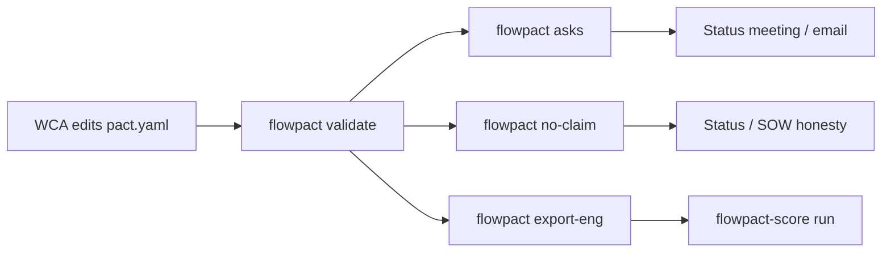

# Flowpact Open-Source Design

## 0. Repo layout

```text
flowpact/
  docs/design/FLOWPACT_PLAN.md
  examples/draft-vs-gold/           # synthetic filled pact.yaml
  schemas/pact.schema.json
  src/flowpact/                     # CLI package
  README.md
```

---

## 1. Problem framing and non-goals

**Problem.** On AI consulting engagements, “how the work runs” and “what done means” live in SOW PDFs, meeting notes, Slack, and regenerating readiness docs. Teams reverse-engineer workflow late, then argue about accuracy with no shared definition of done. Scope boundaries, policy decisions, and evidence requirements arrive piecewise; ask lists get rewritten because there is no single writable artifact.

**Flowpact is.** A **workflow + success pact** for AI products: stages, ownership boundaries, policy decisions, success recipe, evidence required, and open slots. Non-engineers (Workflow Contract Author) write it. The tool validates completeness and emits **ask lists** + **no-claim reports**. Engineers consume a machine export (eligibility, hard gates, out-of-scope).

**Non-goals (do not build or claim in the base package).**

| Adjacent tool                  | What it does                      | Why Flowpact is not that                                                         |
| ------------------------------ | --------------------------------- | -------------------------------------------------------------------------------- |
| Trustline / Great Expectations | SQL / data-seam integrity         | Flowpact does not query warehouses or compile SQL                                |
| RAGAS / DeepEval               | Score free-text answers / traces  | Base Flowpact does not run LLM judges or embeddings                              |
| OpenAPI / JSON Schema          | API or payload shape              | Flowpact does not validate runtime HTTP or candidate JSON schema                 |
| Orchestrators (Airflow, etc.)  | Run pipelines                     | Flowpact does not schedule or execute generation                                 |
| Full RAGAS replacement         | Free-text Q&A eval                | Optional `flowpact-score` is structured draft-vs-gold only                       |

**Positioning.** Flowpact **defines** the success recipe and exports JSON. Optional `flowpact[score]` / `flowpact-score` **executes** that claim (population, hard gates, soft fields, aggregate, regression diff). Trustline audits data seams; RAGAS remains adjacent free-text eval.

**One-line positioning.** Data contracts certify seams; eval kits score free-text outputs; Flowpact certifies that the **engagement has defined workflow and success rules — and knows what is still missing**.

---

## 2. Core objects / pact schema

**Authoring decision (locked):** One source file `pact.yaml` (comment-friendly, copy-from-template). Humans read Markdown via `flowpact render`. No dual-edit of MD+YAML (avoids drift).

**Top-level shape:**

```yaml
flowpact: "0.1"
meta:
  name: string
  client: string
  engagement: string
  owners: { wca, delivery_lead, client_sponsor }
  updated: date

glossary: [{ term, plain_english }]

process:
  stages: [{ id, name, owner, in_scope: bool, does, inputs, outputs }]
  boundary_note: string   # e.g. stop before downstream publish

policies:
  - id: string
    question: string
    status: resolved | open | blocked_on_client
    options: [string]     # when open
    decision: string|null
    owner: string
    blocks: [claim_id]    # which claims this gates

success:
  claims:
    - id: answer_quality
      statement: string   # plain language
      population:         # eligibility
        include: [{ field, rule }]
        exclude: [{ field, rule }]
      hard_gates: [{ field, rule, on_fail: zero_score }]
      soft_fields: [{ field, method, weight }]
      aggregate: string   # e.g. mean_score >= 0.90
      not_measuring: [string]
  engineering_tracks:     # tracked but not the headline claim
    - id: eng_quality
      statement: string
      blocks_claim: false

evidence:
  - id: labeled_holdout
    what: string
    required_for: [answer_quality]
    status: missing | partial | delivered
    acceptance: [string]  # N, format, access method
    owner: string
    ask: string           # stakeholder-facing ask text

open_slots:               # derived + explicit; validate merges both
  - id: string
    severity: critical | high | medium
    status: open | resolved
    ask: string
    owner: string
    blocks: [claim_id]
```

**Derived outputs (computed, not hand-maintained as source of truth):**

- **Ask list** = every `evidence` with `status != delivered` + every `policy`/`open_slot` with `status` in `{open, blocked_on_client}`, sorted by severity and `blocks`.
- **No-claim report** = for each `success.claims[]`, list blocking open slots/evidence/policies; exit non-zero if any claim has blockers when `--strict`.
- **Eng export** = JSON: `export_schema`, `population`, `hard_gates`, `soft_fields`, `out_of_scope_stage_ids`, `resolved_policies` — consumer for optional `flowpact-score`.



---

## 3. WCA persona and week-1 happy path

**Persona — Workflow Contract Author (WCA).** Engagement-facing; not required to code. Owns the living pact. Closes open slots in meetings; does not invent eng scores.

**Week-1 path:**

1. Day 1: `flowpact init --template ai-draft-vs-gold` → `pact.yaml` with empty required sections and commented examples.
2. Day 1–2: WCA fills `process.stages` + `boundary_note` from kickoff (what we build vs downstream systems).
3. Day 2: Draft `success.claims` in plain English first; add population / hard gates only after stakeholders confirm the yardstick.
4. Day 2–3: List `evidence` rows for anything the claim needs. Mark `missing`.
5. Day 3: Capture known unknowns as `policies` with `status: open`.
6. Day 3: `flowpact validate` → fix schema errors; `flowpact asks` → paste into email / one-pager; `flowpact no-claim` → share “we cannot claim X until …”.
7. Ongoing: meetings only **resolve slots**; eng reads `export-eng.json`; never re-derive workflow from Slack.

---

## 4. Synthetic worked example (draft-vs-gold)

Concrete filled pact: [`examples/draft-vs-gold/pact.yaml`](../../examples/draft-vs-gold/pact.yaml) — **Northwind Benefits Answer Copilot** (fully synthetic domain: draft policy answers vs SME gold).

**process (in scope):** Policy corpus → Retrieve → Draft → Score → Human review. **Out of scope:** Help-center publish.

**Headline claim `answer_quality`:** citation URL hard gate + answer body (`token_overlap`) / topic tag (`exact_match`) soft fields; aggregate `mean_score >= 0.90`. Holdout: `gold.jsonl` / `drafts.jsonl`.

**Engineering track:** retrieval recall — does not block the headline claim.

**Spike artifacts:** `asks.hand.md`, `no-claim.hand.md`.

---

## 5. v0 scope (CLI only, no SaaS)

**Stack:** Python 3.11+, PyYAML, JSON Schema validation, Typer.

**Commands:**

| Command               | Behavior                                                                                    |
| --------------------- | ------------------------------------------------------------------------------------------- |
| `flowpact init`       | Write `pact.yaml` from `ai-draft-vs-gold` template                                          |
| `flowpact validate`   | Schema + referential checks (`blocks` IDs exist; open policies that block claims warn/fail) |
| `flowpact asks`       | Markdown/stdout ask list                                                                    |
| `flowpact no-claim`   | Per-claim blocker report; `--strict` exit 1 if any claim blocked                            |
| `flowpact render`     | Human-readable Markdown (process diagram as Mermaid, glossary, claims)                      |
| `flowpact export-eng` | `export-eng.json` for `flowpact-score` / harness consumers                                  |
| `flowpact-score run`  | Optional: draft-vs-gold score from export-eng + gold/drafts JSONL                           |
| `flowpact-score diff` | Optional: regression compare of two score manifests                                         |

**Ship in v0:** JSON Schema, one template, synthetic example under `examples/draft-vs-gold/`, README with positioning vs Trustline/RAGAS, Apache-2.0.

**Optional score extra:** offline `exact_match` / `token_overlap`; embedding/LLM methods behind extras only (stubs in MVP).

**Explicitly out of core/base:** UI/SaaS, SSO, SQL checks, required LLM/embed deps, git PR bots, auto-email, warehouse auditing.

---

## 6. Where code lives (locked)

| Location | What |
| --- | --- |
| **This repo (`flowpact`)** | Package, CLI, schema, templates, `examples/`, CI, PyPI later |

---

## 7. Risks and decisions

- **Pact becomes another unread doc** unless `asks` / `no-claim` are used in every status meeting.
- **Over-schema** scares WCAs — keep v0 fields minimal.
- **Success formula drift** — the pact must record the **agreed** recipe; WCA resolves conflict as a policy.
- **Name collision** with “data contracts” — README must lead with non-goals.
- **Example hygiene** — ship only synthetic domains in public examples; never mirror real engagement field names or workflows.

---

## 8. Phased plan

**Phase 0 — Design freeze.** Schema + synthetic example agreed.

**Phase 1 — Spike.** Hand-write example pact; simulate asks / no-claim.

**Phase 2 — OSS skeleton.** Packaging, commands, JSON Schema, CI, README.

**Phase 3 — Score extra + engagement rollout.** Optional `flowpact-score` reads `export-eng.json`; WCA training.

**Phase 4 — Harden.** Pact version diffs; more templates (`rag-chat`, `agent-workflow`).
